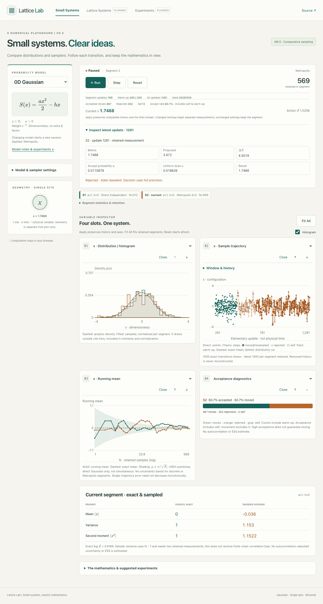
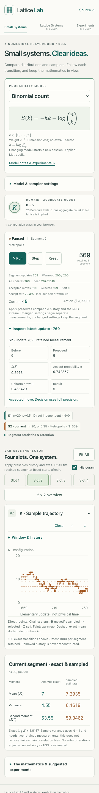
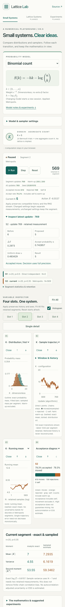

# M0.5 review evidence

M0.5 extends the deployed one-variable Gaussian lab to Gaussian, single-spin and binomial models with independent and Markov sampling. The implementation contract is in specification sections **2.1, 4.2, 5.3–5.4, 6.1–6.3 and 7.3**, with numerical conventions in decisions **D-019–D-020**.

## Validation

`npm run check` passes formatting, TypeScript, **103 unit tests**, production build and **36 browser tests** (desktop Chromium, 360px mobile Chromium, emulated iPhone WebKit). The browser suite runs the static production build under `/lattice/`. It covers Run/Pause/Step across thousands of transitions, warm-up exclusion, model and sampler switching, exact/sample labels, histories, Reset/Fit All, keyboard controls and phone layouts. This is emulation, not a physical-phone benchmark.

Numerical benchmarks include independent transition-matrix detailed-balance/stationarity checks and covariance-based frequency tolerances for small discrete chains, Gaussian Metropolis ensemble moments, direct-sampler moments, exact normalization at supported parameter extremes, and exact seeded equality of batches and individual steps. Histograms, moments, convergence checkpoints and transition/counter records are cross-checked against the same sequence.

## Screenshots

Captured from the production build. Counts can differ between screenshots because the capture pauses at a completed worker batch. No screenshot is a statistical benchmark.

### Desktop — direct Gaussian versus Metropolis

### Phone — binomial trajectory detail

### Phone — four-slot overview

## Remaining limits

- Metropolis warm-up is a configurable fixed budget, not proof of equilibrium or mixing.
- Independent-Gaussian uncertainty bands apply only to direct Gaussian segments. MCMC confidence intervals, ESS and autocorrelation analysis remain deferred.
- Eight recent segments, each with at most 1000 exact recent transitions. Evicted transitions are not reconstructed; all retained measurements still contribute to that segment’s online statistics.
- Binomial teaching range is integer n=1–100 and p=0.001–0.999; singular endpoint fields are rejected explicitly.
- Model-family changes start fresh sessions. No graph editing, coupled fields, periodic lattices, exports, persistence, sweeps or full experiment manager.
- Feature-branch validation does not deploy M0.5. Merge and deployment remain separate, user-controlled steps.
