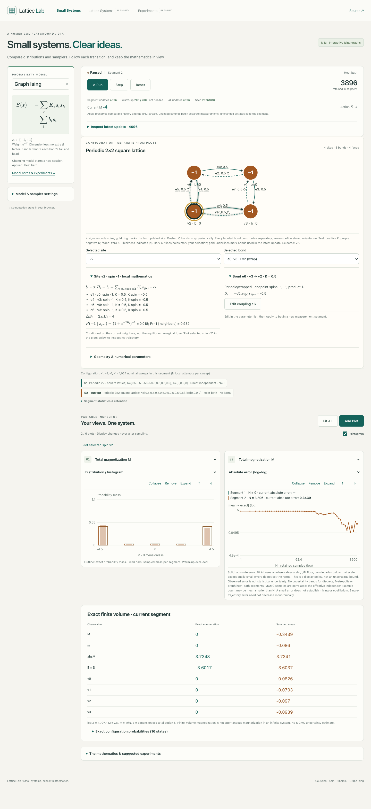
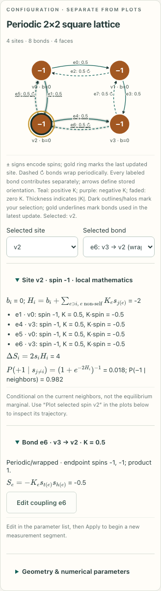
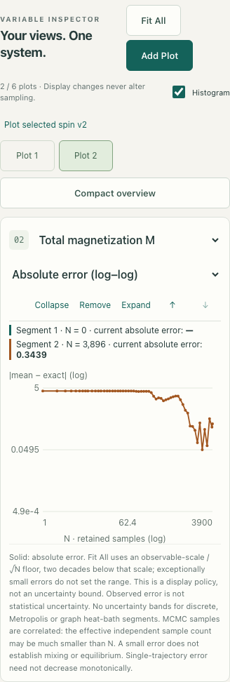

# M1a refinement review

Based on main `dae1a5a` (merged M1a PR #3), branch `codex/m1a-local-inspection`. Specification sections 3.4, 6.3 and 7 and decision D-025 define this focused refinement.

## Changes

- Selected site and Selected bond synchronize diagram and dropdowns. Compact collapsible panels expose local fields, non-self incident contributions, flip costs, exact neighbor-conditioned probabilities, bond products/actions and topology classification. Dark selection highlights are distinct from gold latest-update marks. Desktop panels share a row; phone panels stack and start collapsed.
- Edit coupling opens and focuses the existing field. It does not apply a draft; validation, parameter segments, RNG preservation and configured warm-up still use the existing Apply route. The selected-spin plot action reuses existing plots.
- Exact odd means pair global spin reversals with pair probability mass × tanh(b·s). Zero fields produce exact zeros; an isolated 1e−18 field still produces a nonzero response alongside K=10 pair actions. Exact tables and plotted references share the same means.
- Log error plots use an explicit observable-scale/N floor rather than the smallest observed error. Zero and below-floor positive checkpoints are counted and omitted with broken lines; all-zero histories are labeled. Per-segment current absolute error and retained N stay visible. Automatic axes expand only, Fit All uses the disclosed fitting policy, Reset clears/reseeds/refits.
- Text distinguishes observed error, estimator uncertainty and MCMC correlation. Direct Gaussian pointwise bands/RMS references remain; no independent bands are added for local chains. Exact tiny-chain spectral/autocorrelation diagnostics are roadmap-only.

## Validation

`npm run check`: formatting, typecheck, **163 unit tests in 16 files**, production build, **54 browser tests** across desktop Chromium, 360px phone Chromium and emulated iPhone WebKit. `git diff --check` passes.

Added checks cover signed/strong-coupling symmetry, tiny nonzero field responses, local fields/complete-action differences and conditional enumeration with parallel/self bonds, individual bond contributions, zero/near-zero/ordinary error histories, constant observables, omission messages/readouts, stable axes and Fit All. Browser tests synchronize graph/dropdowns, open local mathematics, focus coupling edits without applying, verify new measurement segments, and replay identical seeded transitions after display-only inspection. Existing warm-up/segment/isolation/batching and desktop/mobile controls remain covered.

## Visual evidence

Production screenshots reviewed for readable math, touch controls, clipping/overflow, compact collapsed panels and separate numerical/read-only controls. Both panels are deliberately expanded below to show their contents. These are short trajectories, not claims of equilibrium or mixing quality.

## Limits

No M1b models, larger lattices, transition-matrix spectral system, autocorrelation/ESS estimator or M3 experiment manager. Fixed warm-up and a small observed error do not establish mixing. Exceptionally small error checkpoints are intentionally omitted from the log plot, with disclosure; the current numerical error is still shown. Phone validation is emulated, not a physical-device performance benchmark. Static `/lattice/` deployment and dependency set are unchanged; this branch does not deploy or merge itself.
