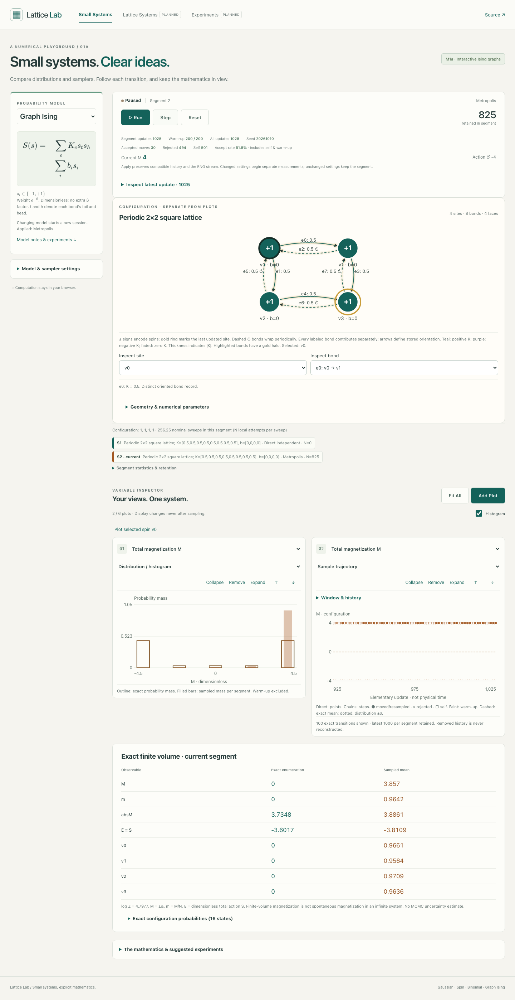
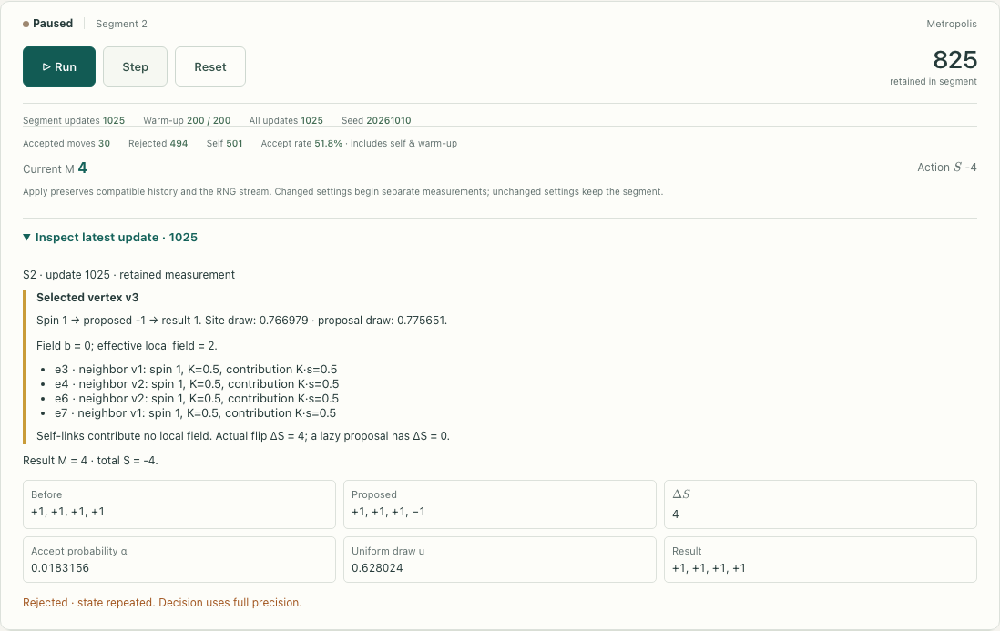
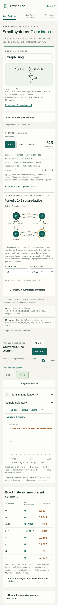
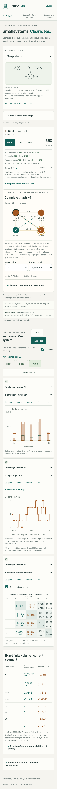
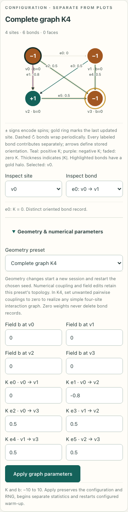

# M1a review evidence

M1a extends the merged M0.5 laboratory to interacting finite Ising systems. It is based on `main` at `056ac30` (M0.5 PR #2), on branch `codex/m1a-small-graph-ising`. Specification sections **2.1, 3, 4.2, 5.3, 6.1–6.2 and 7** describe the behavior; decisions **D-021–D-024** record numerical conventions and the revised preset-only editor.

## Implemented behavior

- Seven presets: single site, open/periodic four-site chains, open 2×2 square, star, K4 and periodic 2×2 torus. The torus retains eight oriented bonds and four signed plaquettes. Domain and drawing coordinates are separate.
- Preset selection plus compact numeric lists for couplings and site fields. Positive, negative and zero weights are labeled and distinguished visually. K4 zero weights realize arbitrary simple four-site interaction graphs. **No graphical edge creation/deletion or vertex dragging.** Zeroing a weight does not delete its domain record or any face.
- Exact enumeration of all at most 16 configurations, log Z, configuration probabilities, site marginals/means, total/mean/absolute magnetization, dimensionless total action E=S, pair correlations and connected covariance. Exact results are available before sampling.
- Direct exact configuration draws, random-site lazy Metropolis and local heat bath. Actual Step traces include selected site, neighboring contributions, fields, proposal/conditional probabilities, random draws and resulting spins. The graph highlights selected/updated sites and incident bonds.
- Two default plots (M distribution/trajectory for graph Ising), Add Plot and zero-to-six independent views with remove/collapse/reorder/expand. Existing SVG distribution/trajectory/convergence components are reused through read-only observable projections. Site selection can add that spin’s plot. Phone detail and optional compact overview avoid mandatory stacks of expanded charts.
- Compatible parameter/sampler changes retain configuration and RNG with new statistics/warm-up. Geometry changes create explicit new sessions. Reset clears/reseeds/refits; Fit All, selection and display controls never sample. Warm-up is excluded from every measurement; rejected/unchanged retained states count normally.

## Numerical architecture and conventions

The dimensionless action is `S=−Σ_e K_e s_tail s_head−Σ_i b_i s_i`, with beta absorbed. Every edge contributes once. Self-links add constants and zero local flip difference. Local updates choose a uniformly random site with replacement; N local attempts are one nominal sweep, not physical time. Metropolis consumes site, lazy-proposal and acceptance uniforms; local heat bath consumes site and resampling uniforms. Direct enumeration uses one inverse-CDF uniform. Existing M0.5 scalar kernels and seeded streams are preserved.

Finite configurations use internal integer bit codes; user-facing configuration displays use ± spins. Independent enumeration supplies exact references. The worker owns the actual configuration, transition ring, configuration frequency counts, and per-observable online moments/logarithmic checkpoints. Each plot transforms these records without altering or regenerating them. Exact and sampled covariance use full segment configuration counts, not only the visible trajectory window. Conditional and correlation panels explicitly show current configuration/segment; distribution/mean/trajectory views compare compatible historical segments.

Storage remains bounded: eight segments, 1000 exact transitions each, at most 16 configuration counts and at most 321 checkpoints per supported scalar observable. No new runtime dependency, backend, persistence or universal plugin framework.

## Validation

**`npm run check` passes:** formatting, TypeScript, **156 unit tests in 15 files**, production build, and **51 browser tests** across desktop Chromium, 360px phone Chromium and emulated iPhone WebKit. `git diff --check` is clean. Existing M0.5 numerical behavior remains covered; fixed-four display expectations are intentionally updated. Additional checks include:

- Independently enumerated actions/probabilities/moments and every local spin-flip difference across all presets with heterogeneous signed parameters; arbitrary two/three-site, parallel and self-link cases.
- Closed signed face walks, zero boundary-of-boundary, torus edge/face multiplicity, and consistent orientation reversal.
- Periodic four-site `Tr(T⁴)` under several signed couplings/fields; independently listed eight-bond torus partition function.
- Exact heat-bath conditionals; transition-matrix detailed balance, stationarity, connectivity and positive diagonals for both local kernels.
- Direct mean checks with analytic standard-error bounds and local-chain ensemble means with **exact finite-chain covariance** tolerances (stationary initial draws), not arbitrary independent-sample error assumptions.
- All 64 simple four-site graphs realized by K4 zero weights; zero-weight torus retains its full cell complex.
- Seeded Step/batch/snapshot equivalence; parameter-switch RNG continuity; warm-up, histograms, moments and convergence from the same segment; bounded histories, no-op settings, Reset and display-only projection/Fit All.
- Constant-action plot ranges without NaN/degenerate axes; authored KaTeX including graph equations; no independent-Gaussian bands on interacting chains.
- Production browser flows under `/lattice/`: all presets, exact tables, numerical edits, zero/negative weights, preserved topology, actual MCMC inspection, dynamic plots, graph keyboard/form selection, narrow-phone layout, settings drafts during Run, thousands of updates, Pause/Step/Resume, seed replay and worker recovery.

## Visual review

Screenshots are from the production build. Sample counts may vary with the completed batch at capture; screenshots are UI evidence, not statistical convergence benchmarks. The torus example deliberately shows a short local chain that has not explored both magnetization sectors well.

### Desktop: genuine periodic 2×2 lattice

### Actual local Step inspection

### Phone: single trajectory detail

### Phone: compact overview

### Phone: numerical parameter list

## Remaining limits

- UI geometry is preset-based. Arbitrary topology/face editing is intentionally omitted. Domain APIs/tests support 1–4 sites and self/parallel edges; the UI’s one/four-site presets retain their mathematical topology.
- Couplings and fields are restricted to finite [−10,10]; the numerical domain bounds edge storage at 16 records. Strongly coupled local chains can mix very slowly. Fixed warm-up is not proof of equilibrium.
- No autocorrelation-adjusted uncertainty, ESS, saved runs, exports or experiment manager. Historical transitions/segments are evicted at the disclosed bounds; remaining full-segment statistics stay intact.
- Phone testing uses 360px Chromium and emulated iPhone WebKit, not physical-phone performance measurements. The compact overview stacks plots to keep touch controls and text readable.
- M1b continuous variables, larger lattices, cluster algorithms, gauge dynamics and Wilson loops remain deferred. Repository licensing remains undecided.
- Local validation does not deploy the feature branch. PR review, merge and main deployment are separate steps; no automatic merge.
