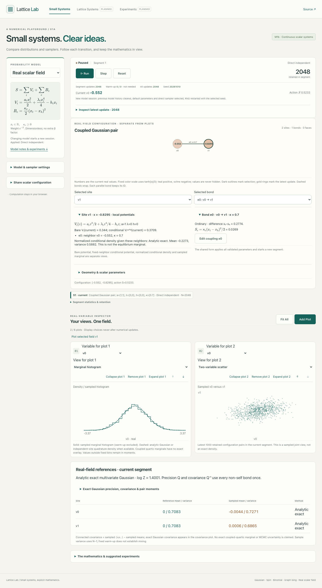
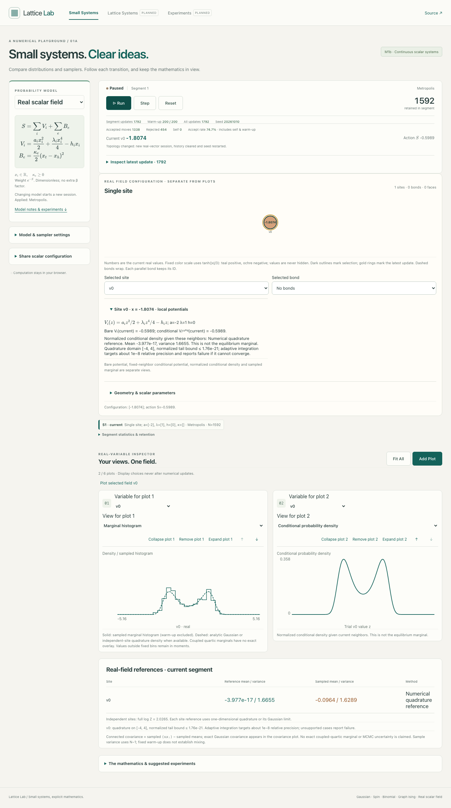
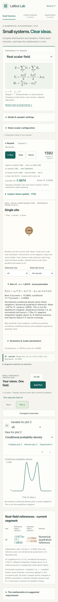
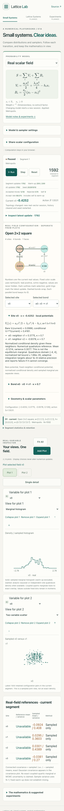
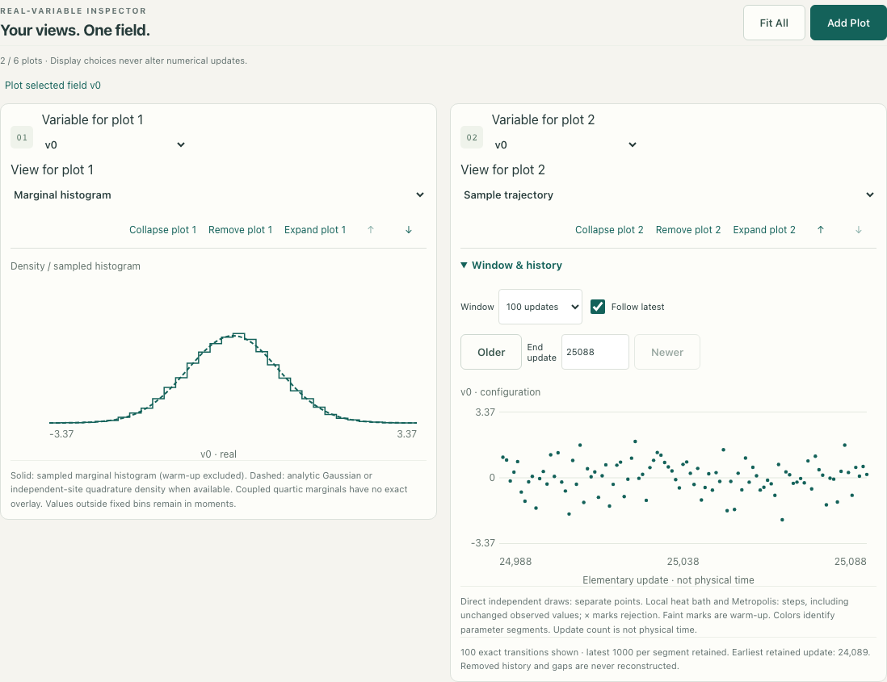
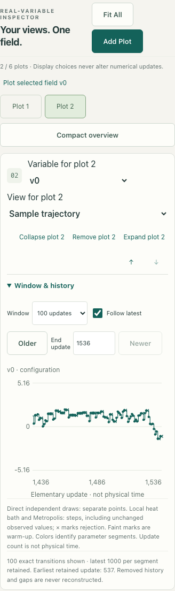
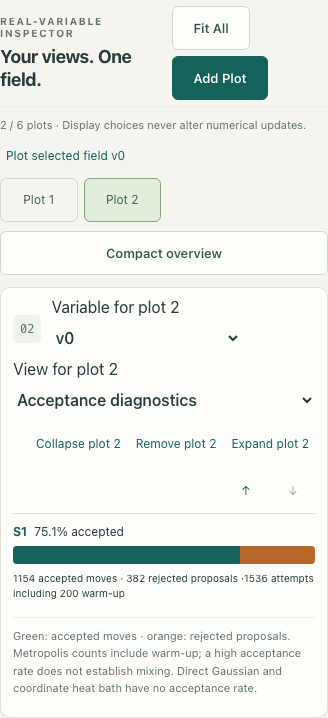

# M1b continuous scalar systems — review evidence

This feature branch starts from the merged M1a refinement (`c967e89`). The implementation follows [specification §4.2](SPECIFICATION.md), the [M1b roadmap gate](ROADMAP.md), and decisions D-026–D-029 in the [decision log](DECISIONS.md). It remains a static browser application at `/lattice/`; the existing Gaussian, spin, binomial, and graph Ising paths remain available.

## Numerical conventions and user-visible behavior

There is one real variable per vertex, with dimensionless action

`S(x) = Σᵢ(aᵢxᵢ²/2 + λᵢxᵢ⁴/4 − hᵢxᵢ) + ½Σₑκₑ(xₜ−xₕ)²`

and weight `exp(−S)`. No extra inverse temperature is applied. Bonds have unique IDs, so parallel periodic bonds contribute separately; self-links have zero gradient contribution, while oriented faces remain part of the domain. The conservative supported range is `−10≤a≤20`, `|h|≤10`, `0≤κ≤10`, with either `λ=0, a≥0.05` or `0.01≤λ≤10`. This is sufficient for normalizability, not the full mathematical region.

The graph shows numeric field values using a fixed color scale. Its site and bond selection controls expose the bare site potential, fixed-neighbor conditional potential and density, incident terms, and bond gradient contribution. The sampled equilibrium marginal is a separate histogram. Gaussian marginals carry analytic references; independent quartic marginals use one-dimensional quadrature references; coupled quartic marginals are sampled only. Six editable presets progress from one Gaussian site through a coupled pair and double wells to four coupled Gaussian or quartic sites. Graph/lattice presets retain the M1a topology, including the periodic 2×2 torus with eight bonds and four faces.

The worker owns a real vector, separate from the old numeric and Ising states. A direct Gaussian update replaces the whole vector; coordinate Gaussian heat bath or random-site Metropolis updates one site. Metropolis uses a uniform displacement `δ(2u−1)`, computes the on-site and individual incident-bond action differences, and records the acceptance draw even when the proposal is downhill. Rejected updates leave the vector unchanged but count as transitions and, after warm-up, measurements. A nominal sweep is N local attempts with replacement, not physical time. Run and Step use the same seeded worker sequence.

For a Gaussian model, every non-self bond enters precision `Q`; a checked Cholesky factor gives analytic `μ=Q⁻¹h`, `C=Q⁻¹`, `log Z`, pair moments, marginals and fixed-neighbor conditionals. Direct draws solve `Lᵀ(x−μ)=z`, giving covariance `Q⁻¹`. The one-site limit agrees with M0. For quartic sites, stationary-point partitioning, shifted exponents and adaptive Simpson integration provide `log Z`, normalized density and moments through fourth order. A convex tail bound controls omitted mass and moments outside the displayed integration interval. Unsupported tolerance is reported rather than presented as a reliable reference. These results are labeled **Numerical quadrature reference**.

Each parameter segment owns its settings, sample count, online target moments, histograms, logarithmic convergence checkpoints, cross-products, and a bounded recent vector trajectory/scatter sample. Compatible parameter or sampler edits preserve the vector and random stream but start a new segment and local warm-up. A topology change starts a new seeded session. Up to eight segments and 1000 recent exact vector transitions per segment are retained. The plot system offers zero to six display-only slots; the two defaults are a marginal histogram and, for the coupled pair, a two-variable scatter plot. Running means and error views retain separately colored segment histories and references. Fit All only refits viewports; Reset clears history and reseeds. Versioned URL sharing restores a validated configuration and seed as a new session, without measurements.

## Verification

The complete `npm run check` pipeline passes: Prettier, TypeScript typechecking, **174 Vitest unit tests in 19 files**, the Vite production build and **72 Playwright tests** across desktop Chromium, 360px phone Chromium and emulated iPhone WebKit. `git diff --check` also passes. M1b unit tests exercise the one-site Gaussian limit, independent small-matrix `Q/C/log Z` benchmarks, empirical direct-draw covariance, torus/parallel/self-link action differences, local ΔS against full recomputation, high-precision quartic benchmarks including symmetric and strongly tilted wells, parameter validation, independent quartic factorization, worker transition traces, seeded Step/batch replay, display independence, segment isolation and local-chain covariance with between-chain tolerances. Existing M0–M1a regression tests remain in the same pipeline. Browser checks cover graph selection, editable couplings, conditional-versus-marginal labels, plots, historical segment overlay, share URL validation, seeded display replay, and phone overflow and overview controls.

The production build uses Vite base `/lattice/` and locally bundled KaTeX assets. The following production-preview screenshots were inspected for mathematical legibility, graph/plot separation, touch controls, excess whitespace and horizontal overflow. They are illustrative sampled states, not evidence that a local chain has mixed.

## Remaining limits

The accepted parameter bounds deliberately exclude some normalizable actions. The quadrature method is one-dimensional; it does not provide exact coupled-quartic marginals or partition functions. Sampled covariance and a small observed mean error are not MCMC uncertainty estimates or proof of mixing; warm-up is a configurable count rather than an equilibration test. Scatter and exact transition windows are bounded and can omit older updates; older segment summary statistics remain separate. The phone runs are browser emulations, not physical-device performance measurements. M2 larger lattices, HMC, gauge fields, ESS/autocorrelation estimators, generic topology editing and M3 saved-run management remain outside this milestone.

## Plotting refinement — 2026-10-10

Scalar trajectories now default to a 100-update global window and offer 500/1000, Follow latest, Older/Newer and end-update navigation. The x-axis uses the selected window. Direct independent Gaussian draws appear as unconnected points; local heat-bath and Metropolis transitions use steps, including horizontal holds for unchanged observables and crosses for rejected proposals. The UI reports the earliest retained update and does not reconstruct evicted records or connect separate parameter segments. This corrects the previous long-run compression without changing the worker trace, sampler or RNG.

Scalar Metropolis acceptance uses the existing green/orange graphical style, with accepted/rejected counts, percentage, warm-up disclosure and segment colors. Direct Gaussian and coordinate heat bath display **Acceptance N/A** and their draw/resampling counts, since neither has an accept/reject test. Plot navigation and Fit All remain display-only.

Numerical and display regression checks cover a real 102,400-update worker run, window coordinates after 100,000 updates, retained-history boundaries, direct points versus local steps, rejected/unchanged states, segment separation, graphical statistics, N/A modes, seeded Reset replay, and desktop/phone browser interactions. The complete `npm run check` pipeline passes: formatting, typecheck, **178 unit tests in 20 files**, production build, and **78 browser tests** across desktop Chromium, 360px phone Chromium and emulated iPhone WebKit. `git diff --check` passes. The screenshots below were captured from the production preview and visually checked for axis labels, touch controls, color distinctions and horizontal overflow.

