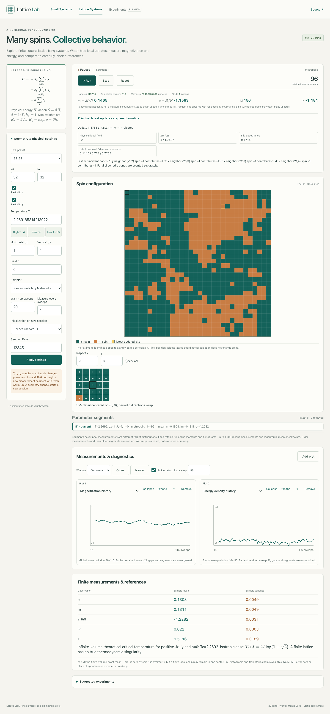
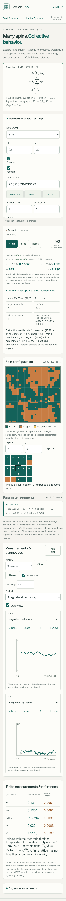

# M2 2D Ising laboratory — feature-branch review

This branch starts from merged M1b on current `main`. It implements [specification §4.2, M2 indexed 2D Ising](SPECIFICATION.md), the [M2 roadmap gate](ROADMAP.md) and decision D-030 in the [decision log](DECISIONS.md). The Small Systems models and their original worker remain available; navigation preserves both workspace sessions. The new Lattice Systems hash route works under the static `/lattice/` base path; no backend or new dependency is used.

## Physics and numerical conventions

Sites are row-major `i=x+Lx*y`. Each +x and +y neighbor generates a distinct oriented bond; periodic length-two axes therefore contribute parallel bonds separately. The 2×2 torus has eight bonds, agreeing with M1a's existing four-face cell complex. Open x/y bond counts are `(Lx−1)Ly` and `Lx(Ly−1)`; each periodic axis contributes `N=LxLy`. Open and periodic choices are independent. The large indexed representation complements rather than replaces the small graph domain.

`H=−Jx Σ_x sᵢsⱼ−Jy Σ_y sᵢsⱼ−h Σᵢsᵢ`, `S=βH`, `β=1/T`, `k_B=1`; M1a's dimensionless weights are `Kx=βJx`, `Ky=βJy`, `b=βh`. Side lengths 2–64, signed `Jx,Jy,h` in [−10,10], and finite `T` in [0.05,100] are supported. A flip has `ΔH=2sᵢ(JxΣ_xsⱼ+JyΣ_ysⱼ+h)` and changes `M` by `−2sᵢ`. The worker stores `Int8Array` spins and incrementally maintains H/M. Full independent recomputation is available and tested. The Canvas draws all spins, while a selected 5×5 neighborhood and the actual latest worker transition expose local structure and distinct incident contributions.

Random-site Metropolis uses the M1a ½-lazy stay/flip proposal and consumes site, proposal and decision uniforms per update, including self-proposals and downhill moves. Heat bath uses site and resampling uniforms, with a stable logistic conditional; an unchanged resampling is not a rejection. Seeded random initialization consumes one uniform per site and is not measured. All-plus/all-minus initializations consume no draws. Run and Step use the same kernel. One nominal sweep is N random-site updates with replacement, not physical time. Warm-up and measurement stride are whole *segment-local* sweeps; a partial sweep yields no measurement. Every retained observation is the actual current state at the scheduled update, including unchanged/rejected states. The horizontal history coordinate is global updates/N, which can be fractional after a mid-sweep quench.

Changing T, Jx/Jy, h, sampler or schedule on unchanged geometry preserves the spins and RNG stream, recomputes physical H, begins an isolated segment and restarts warm-up. Dimensions/boundaries and Reset begin a seeded new session. Each of up to eight segments has separate online moments for m, |m|, e, m² and e², full-segment 41-bin m/e histograms, bounded logarithmic running-mean checkpoints and up to 1,000 recent measurement records. Earlier measurements are evicted from history, not from full-segment statistics. The worker sends one current spin image per bounded 4,096-update Run batch; the display timer is separate. Step advances exactly one update after Pause's in-flight batch acknowledgment. Plot/selection changes consume no randomness.

The two default views are m and e histories; the zero-to-six gallery also offers |m|, histograms, running means and update outcomes. Recent 100/500/1000-sweep windows support Follow latest and Older/Newer navigation. The plot window never maps only the latest observations onto the full global run range, and distinct parameter segments are drawn separately. Histograms normalize by each segment's own count. No independent-sample uncertainty band or MCMC mixing estimate is shown.

## Reference checks

All 16 configurations of both open and periodic 2×2 squares were compared to the independent M1a graph action with `Kx=Jx/T`, `Ky=Jy/T` and `b=h/T`. Tests compare actions, log Z, every local flip cost, heat-bath conditional and full-energy flip recomputation for signed anisotropic couplings. A 2×2 exact panel reports log Z, 〈m〉, 〈|m|〉, 〈e〉, 〈e²〉 and P(m). Both local kernels' 16-state transition matrices satisfy row normalization, detailed balance and stationarity. A zero-field finite-volume spin-flip symmetry check confirms exact mean m=0.

The infinite-volume `sinh(2βcJx)sinh(2βcJy)=1` reference appears only for positive Jx/Jy and h=0. For Jx=Jy=J it reduces to `Tc/J=2/log(1+√2)`. The finite lattice is not claimed to have a true singularity or spontaneous symmetry breaking. Signed interactions and nonzero field receive no inapplicable ferromagnetic Tc reference.

## Pre-merge numerical and inspection correction

The 2×2 reference is now a dedicated 16-state enumeration in physical M2 units. It uses the indexed lattice's actual bond records for open, periodic and mixed boundaries, and normalizes with a lowest-action log-sum-exp offset. Thus every valid M2 `T`, `Jx`, `Jy` and `h` combination renders without encountering M1a's narrower dimensionless UI validator; M1a limits remain intact. Regression tests cover highly concentrated ferro- and antiferromagnetic measures, maximal fields, parameter corners, probability normalization, zero-field symmetry and agreement with M1a inside its supported range. The displayed references remain exact finite-volume quantities, independent of sampled measurements.

The Step trace now shows the selected-spin hypothetical flip `ΔH/ΔS`, the Metropolis proposed-move cost, and the actual transition cost separately. Rejected flips, lazy self-proposals and unchanged heat-bath resamples have actual `ΔH=ΔS=0`; changed transitions have the flip cost. Unit tests verify all five outcomes and unchanged RNG draw counts. The Tc example explicitly sets the draft `Jx=Jy=1`, `h=0`, `T≈2.269`; Apply continues to begin a separate segment. A production browser regression applies maximal couplings/field at `T=0.05` on 2×2, then Steps and Runs while checking for React errors; a browser test checks the preset draft and Apply semantics.

## Validation and performance

The full `npm run check` pipeline passes after updating the existing navigation-count test for the newly available second workspace: Prettier, strict TypeScript, **190 Vitest unit tests in 22 files**, production Vite build and **90 Playwright tests** across desktop Chromium, 360px phone Chromium and emulated iPhone WebKit. New browser checks exercise 2×2 exact display, Step trace, 16/32/64 worker sampling, Run/Pause/Step, parameter quench/Reset, display-only plots, heat-bath N/A outcomes, workspace-session preservation and horizontal overflow. Existing M0–M1b browser tests still pass. Unit checks also cover bond multiplicities, signed anisotropic energy, 30,000 alternating local updates against full recomputation, seeded Step/batch equivalence, partial sweeps, segment isolation, invalid settings, and one million updates with bounded history.

After the pre-merge correction, the full formatting/typecheck/unit/build/browser pipeline passes with **204 Vitest unit tests in 24 files** and **96 Playwright tests** across the same three browser projects. The added browser cases exercise the extreme low-temperature 2×2 Step/Run path without a React error and the explicit Tc preset's draft/segment behavior on desktop and both phone projects. The first sandboxed browser attempt could not bind the local preview port; rerunning with local-server permission passed all 96 tests. No changes to the samplers, measurements or RNG policy were required.

On this development machine, a local production Chromium run with 2-second timed Run intervals completed approximately 192,512 updates for 16×16, 196,608 for 32×32, and 192,512 for 64×64 (roughly 94–96 thousand updates/s including worker/UI scheduling). These are short, environment-specific throughput observations, not hardware-independent benchmarks. Pause remained responsive in the browser checks. Phone screenshots/tests use emulation; no physical-phone speed claim is made.

## Visual review

Screenshots are from the production build after a short seeded run and a real Step. They show the retained visual identity, readable local mathematics, complete lattice, distinct spin/selection colors, measurement plots and phone overview without horizontal overflow. Their sampled states are illustrations, not proof of equilibration.

## Known limits

The supported domain starts at 2×2; one-dimensional `Ly=1` is deferred so vertical self-links and 2D-theory labeling are not accidentally introduced. Nearest-neighbor bond-product averages and long-range correlations are deferred; M2 currently provides m, |m|, e and their selected moments. Exact enumeration is displayed only for 2×2 boxes, including mixed-boundary cylinders. The 5×5 detail is a local inspection aid rather than a general zoom/pan editor. A fixed warm-up count does not guarantee equilibration, particularly near criticality; no autocorrelation/ESS/error-bar estimator, cluster algorithm, saved experiment manager or physical-phone benchmark is claimed. The branch is not merged or deployed by this review.
