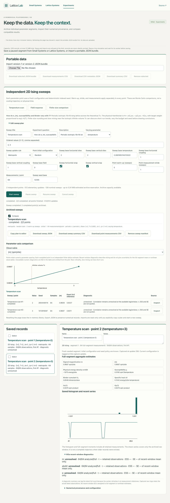

# M3b2 review — independent 2D Ising sweeps

## User-visible result

The Experiments workspace has editable temperature, field and finite-size presets, a visible update/archive budget, Start/Pause/Resume/Cancel, per-point progress and an archived numeric parameter-axis comparison. A user may compare up to three sweeps on the same varying axis and select m, |m|, physical e=H/N, susceptibility, Binder U₄, cV, directional bond products, or available recent-window m τ/ESS/SE diagnostics. The table retains individual seed, sample count, diagnostic status/reason and a link to each source record; a separately labeled exact finite-volume value appears for 2×2 physical observables. Every saved sweep exposes its sampler, initialization, boundary conditions, base parameters, warm-up and stride. A theoretical infinite-volume Tc marker is conditional on an isotropic Jx=Jy=1, h=0 temperature scan; the plotted estimates themselves remain finite volume.

The workflow stays in browser memory with no backend or automatic persistence. A version-2 JSON bundle contains the complete sweep manifest and its completed numerical records. Version-1 M3b1 record bundles still import. A sweep summary CSV reports physical parameters, work counts, observable estimates and diagnostic quality; a separate measurement CSV carries the available ordered m, |m| and physical e diagnostic rings. The JSON bundle is the authoritative portable format. Imported sweeps are read-only until the user copies a plan and starts a new run.

## Numerical and provenance conventions

The physical Hamiltonian is `H=−Jx Σ_x sᵢsⱼ−Jy Σ_y sᵢsⱼ−h Σᵢsᵢ`, with target mass proportional to `exp(−H/T)` and one nominal sweep equal to N random-site elementary updates. The existing M2 indexed topology, local Metropolis and heat-bath transition kernels, and M3a measurement definitions are reused unchanged. Each parameter point creates a new `LatticeRun` with its own initialization, deterministic seed, warm-up and whole-sweep measurement stride. No point inherits spins or RNG state from an earlier point. The seed rule is `(baseSeed + imul(index+1, 0x9e3779b9)) >>> 0`; the rule name, base seed and resulting per-point seeds are stored in the plan/manifest. A plan is copied at Start, so editing the form cannot mutate a running sweep.

The worker advances in bounded update batches and waits for the UI to acknowledge archival of a completed point before starting another. Pause/Resume retain the current worker, spins and RNG state. Cancel preserves already completed captures and marks the unfinished point `discarded-partial` or `not-started`; a partial point is never represented as a completed equilibrium estimate. If archive capacity changes during a run, the worker waits while one completed capture remains staged in memory; the UI reports the issue and offers a retry or Cancel. Existing library records are never evicted. One point may have at most 8192 retained measurements, and only m, |m| and e have complete raw diagnostic series at that maximum. Other observables use their recorded full-segment aggregates; the older 1000-point plot series remains bounded. At point completion, read-only M3a analysis refreshes the summary against the final diagnostic ring without drawing RNG or changing moments, spins or update count.

The manifest records the immutable plan, point order, varied numeric value, physical parameters, seed, requested and actual updates, measurement count, status and completed dataset ID. Completed IDs must resolve uniquely to records with matching source seed, initialization, workspace, schedule, physical parameters, sample count and fresh-seeded provenance. Browser-local source-record IDs disambiguate repeated imports of identical scientific IDs; they never replace the portable provenance. Version-2 import validates all scientific records and references before updating the in-memory library; it preserves M3b1's 16-record, 12 MiB archive and 16 MiB input limits. Version-1 imports retain their original interpretation. CSV uses M3b1's RFC 4180 escaping and prefixes formula-like text fields with an apostrophe, including after leading whitespace/control characters; numeric negative values remain numeric.

The full-segment means, susceptibility, Binder and heat capacity are point estimates, not values with inferred standard errors. M3a τ, ESS and SE describe the recent analyzed window only. No recent-window SE is attached to a full-segment mean or nonlinear observable. Near criticality, finite-size rounding, metastability and slow mixing can make a short scan misleading. Parameter-axis lines connect independent estimates for visual comparison, not a time trajectory or fitted critical exponent.

## Validation and resource bounds

Tests compare sweep points with independently constructed ordinary `LatticeRun` instances for signed anisotropic couplings and mixed boundaries, including identical complete captures under distinct batch sizes and a Pause/Resume. A rapidly mixing independent 2×2 field scan agrees with exact finite-volume m and e within a deliberately loose stochastic tolerance. Additional regressions cover point seeds and geometry assignments, 8192 raw observations, final diagnostic coverage at 257 samples, cancellation after several completed and one partial point, zero-point cancellation, capacity preflight, version-1 compatibility, repeated version-2 imports, atomic rejection of inconsistent provenance, CSV numeric/formula behavior, repeated Start and stale worker replies. The browser smoke test runs a two-point scan, comparison, JSON download, page reload and import in desktop Chromium, 360px Chromium and iPhone WebKit, checking horizontal overflow and preservation of both mounted interactive workspaces. The default seven-point preset is also run in desktop Chromium.

Local desktop production Chromium observation: the default periodic 16×16, seven-temperature, 100-warm-up/256-measurement-per-point scan requested 637,952 elementary updates and completed in about 1.4 seconds; its version-2 JSON bundle was 277,235 bytes. This is a short, environment-specific UI/worker/archive measurement, not a controlled throughput benchmark or physical-phone timing. M3a's earlier approximately 93k updates/s two-second interactive Run observation used a different UI scheduling path, so the figures should not be interpreted as a sampler-speed improvement. The configured 10-million-update, 12-point and 8192-measurement limits remain hard caps, with an additional conservative archive reservation; some combinations within the numerical caps cannot fit under the 12 MiB library limit.

The final `npm run check` passed Prettier, TypeScript, 269 unit tests across 33 files, the Vite production build, and 124 production-browser tests across desktop Chromium, 360px Chromium and iPhone WebKit. Two additional instances of the desktop-only resource sample are intentionally skipped on phone/WebKit; the functional sweep smoke and live-workspace isolation tests run in all three profiles. The first full browser run exposed duplicate accessible form labels from the mounted sweep editor; unique sweep-specific labels resolved the conflict, and the final full run passed.

No M3c models, two-parameter grids, cluster updates, critical-exponent fit or backend were added. Fatal worker crashes cannot certify the interrupted point's final work count; completed point records remain separately exportable and the UI does not fabricate a completed sweep manifest in that case.
